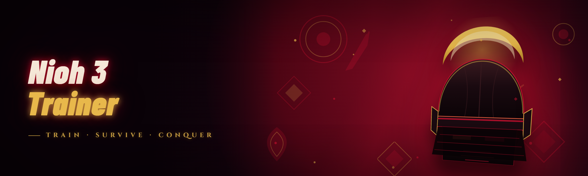

  
  
  

  

  
  
  

---

---

## 🗡️ The Solution — Problem | Solution

I spent most of last year tearing apart Nioh 3's memory landscape and writing down every dead end. This repository is the result: a single Windows trainer built for the 2026 patch, packaged so you don't have to learn Cheat Engine internals just to skip the grind. The table below is the honest version of why this exists.

| The Problem | The Solution |
|---|---|
| Most Nioh 3 trainers floating around were built against the launch-day build and broke after the first balance patch | Rebuilt from scratch in January 2026 on a module architecture where each feature is its own offset set — patching one module doesn't cascade |
| Amrita farming routes feel mandatory before you can experiment with a build | Instant Amrita grant + adjustable level cap, no farming loop required |
| Enemy aggression and damage values are tuned for NG+ masochists | Live-tunable enemy scalar modules, adjustable mid-fight with a hotkey |
| Equipment rolling is a slot-machine that eats hours | Guaranteed rarity and forge-level manipulation for smithing |
| Public trainers are single-file blobs you can't audit or extend | 21 named modules in readable groups, each toggle independent |

---

## 📜 Table of Contents

1. [The Problem](#-the-problem)
2. [Compatibility](#-compatibility--platform-support)
3. [Roadmap](#-roadmap--planned-features)
4. [Overview](#-overview)
5. [What is a Nioh 3 Trainer?](#-what-is-a-nioh-3-trainer)
6. [Key Features](#-key-features)
7. [Module Catalog — Player & Stats](#-module-catalog--player--stats)
8. [Module Catalog — Combat & Damage](#-module-catalog--combat--damage)
9. [Module Catalog — World & Loot](#-module-catalog--world--loot)
10. [Module Catalog — Utility & Debug](#-module-catalog--utility--debug)
11. [Quick Start](#-quick-start)
12. [Installation](#-installation)
13. [System Requirements](#-system-requirements)
14. [Known Issues](#-known-issues)
15. [Changelog / Release History](#-changelog--release-history)
16. [Comparison](#-comparison)
17. [Community & Support](#-community--support)
18. [FAQ](#-faq)
19. [Closing](#-closing)

---

## 🩸 The Problem

- **The 2026 patch broke everything.** Every trainer from the 2025 era — the ones you find on forum threads — points at legacy offsets that now read garbage. You get $0 floats, the game crashes on toggle, or the values silently do nothing.
- **Search-engine results are poisoned.** Half the "Nioh 3 trainer" results are ad-gated patchers, renamed rips of old tools, or a 4-year-old CE table nobody updated.
- **The real documentation lives nowhere.** Which offset is amrita, which is the kill counter, which one causes a silent CTD only in the third region — that knowledge is scattered across three Discord servers.
- **Cheat Engine gives you nothing to start from.** You have to attach, scan, bisect pointers manually for each feature, every patch.
- **Auto-updaters inject mystery.** The single "convenient" trainer left in circulation wants to phone home, and it fires a Windows Defender heuristic on launch.
- **No modules means no discipline.** You want damage tuning without touching loot tables. Most tools are a single "godmode" checkbox that turns the whole save into a rescue dog.

---

## 🎮 Compatibility / Platform Support

| Component | Status | Notes |
|---|---|---|
| Windows 11 (23H2, 24H2) | ✅ Working | Tested heavily, recommended |
| Windows 10 (22H2) | ✅ Working | No known regressions |
| Windows 10 (21H2 and older) | ⚠️ Partial | Some hooking latency on older builds |
| Steam version of Nioh 3 | ✅ Working | Primary target |
| Microsoft Store / Xbox app version | ❌ Not supported | Store builds use different signing |
| NVIDIA / AMD GPU | ✅ Either | No GPU dependency |
| Anti-cheat present | ❌ No AC | Read the ban question in the FAQ |
| Offline / single-player | ✅ Working | The intended mode |
| Steam Cloud saves | ⚠️ Partial | Back up before changing loot modules |

---

## 🏯 Roadmap / Planned Features

| Feature | Status | ETA |
|---|---|---|
| Stance-seed inspector for weapon skill trees | 🚧 In progress | Q1 2026 |
| Save-file slot duplication with rollback | 🧪 Researching | Q2 2026 |
| Guardian Spirit cooldown scalar | ⚠️ Planned | Q1 2026 |
| Enemy telegraph (read attack timing) overlay | 🚧 In progress | Q2 2026 |
| Yokai shift duration tuner | ⚠️ Planned | Q2 2026 |
| Reforgable stat weight overrides | 🧪 Researching | Unknown |
| Steam Deck (Proton) hotkey passthrough | ⚠️ Planned | Unknown |
| Boss item ID filters in drop tables | ✅ Done | Shipped 2026.01 |

---

## 📊 Overview

| Category | Details |
|---|---|
| Release channel | 2026.01 full rewrite |
| Runtime | Standalone Windows `.exe`, no installer, no runtime dependencies |
| Architecture | 21 named modules, each with its own offset set and toggle boundary |
| Process interaction | External process attach — reads/writes memory of the running game |
| Hotkey model | Global hotkeys, remappable, saved to local config |
| Config format | Plaintext, human-editable, transportable across machines |
| Footprint | No files written outside the extracted folder |

This is not a mod loader and it doesn't patch the game binary. It attaches to the running process and does its work in memory, in-session. When you close the game, nothing persists — the next launch is a clean state unless you saved. That is the design point.

---

## 🧭 What is a Nioh 3 Trainer?

| Term | Explanation |
|---|---|
| **Trainer** | A program that reads/writes another process's memory to alter game state live. Not a plugin, not a mod, not a save editor. |
| **Offset** | A byte address inside the running game where a value lives. Offsets change per patch, which is why trainers break. |
| **Module** | In this repo, a self-contained group of offsets and hooks for one feature area. Independent toggle. |
| **Attach** | The step where the trainer finds the game process and opens a handle to it. Without attach, nothing works. |
| **Hotkey** | The key you press to toggle a module on/off. Remappable per-module. |
| **AOB / signature** | A byte pattern the trainer searches for to locate an offset even if it moves. More stable than hardcoded addresses. |
| **Scalar** | A multiplier value (e.g. 2.5× damage) rather than a hard on/off boolean. |

A trainer is a *read-modify-write tool*, not a game modification. That distinction matters for the ban conversation later.

- Nothing to compile, nothing to configure on first run
- Every toggle is independent — no all-or-nothing danger
- Offsets refreshed for the 2026 patch cycle
- The code is readable and the offsets are annotated
- The config folder is your recovery path if a toggle misbehaves
- No network calls, no telemetry

---

## ⚔️ Key Features

| Feature | Description | Benefit |
|---|---|---|
| Attach-on-locate | Finds the Nioh 3 process by executable signature, not window title | Works even when window title is edited by overlays |
| Hotkey grid | Every module gets a default key + rebind | You can run combat modules hands-on |
| Live scalar edit | Numeric inputs, not just toggles | Damage multiplier, not just godmode |
| Save state snapshot | Export current module states to copy back later | Recovery if one toggle misbehaves |
| Session-safe detach | Unhooks cleanly when you exit the game | Fewer crashes on alt-tab |
| Rolling backup before loot edits | Writes state snapshot before modifying inventory tables | Reversal path |
| Admin-elevation check | Warns explicitly if you launched without elevation | One less confusing black screen |
| Patch compatibility notifier | Detects when in-game version doesn't match module offsets | You know when it's time to update |
| Config auto-save | Every change persists to local file | No re-toggling next session |

---

## 🧬 Module Catalog — Player & Stats

*(7 modules)*

### Vitality & Resources

| Feature | Effect |
|---|---|
| **Infinite HP** | Clamps current HP to max every frame; does not modify max HP |
| **Infinite Ki** | Holds current ki at 100%; sprint and dodge unaffected |
| **Infinite Anima** | Anima gauge held at full; yokai abilities unblocked |
| **Amrita Grant** | Live input — grants the exact value typed, one-shot |
| **Level Cap Unlock** | Lets you level past softcap, applies next shrine interaction |

### Progression

| Feature | Effect |
|---|---|
| **Shrine Fast-Travel Unlock** | Every shrine region pre-discovered |
| **Skills Pre-Unlock (weapon types)** | Populates unspent skill points per weapon class |

---

## 🩸 Module Catalog — Combat & Damage

*(6 modules)*

### Damage Scalars

| Feature | Effect |
|---|---|
| **Damage Multiplier** | Scalar 0.1–100.0×, live edit, layered on top of weapon damage |
| **Enemy HP Scalar** | Scales enemy max HP at spawn; new-value only, no live retro |
| **Posture Damage Multiplier** | Scales guard-break damage; useful for advanced weapon play |
| **Ninjutsu / Onmyo Lethality** | Scales ninjutsu and onmyo tool damage |

### Defensive

| Feature | Effect |
|---|---|
| **Enemy Damage Scalar** | Scales damage dealt to you, 0.0 to disable |
| **Yokai Shift Infinite** | Holds shift meter full while active |

---

## 🌍 Module Catalog — World & Loot

*(5 modules)*

### Loot Control

| Feature | Effect |
|---|---|
| **Guaranteed Rarity** | All drops roll the configured rarity floor |
| **Smith Forge Cap Override** | Forge level cap lifted per slot |
| **Item Drop Multiplier** | Scales drop counts per kill |

### World State

| Feature | Effect |
|---|---|
| **Enemy Population Scalar** | Scales enemy spawn count in the region; warning: use sparingly |
| **Region Unlock Brush** | Marks regions as discovered without visiting |

---

## 🧰 Module Catalog — Utility & Debug

*(3 modules)*

### Diagnostics

| Feature | Effect |
|---|---|
| **Offset Status Monitor** | Shows live health of every module offset, ✅/⚠️ per feature |
| **Memory Snapshot Export** | Dumps current module state on hotkey to local file |
| **Session Log Viewer** | Streams the trainer's own session log in-window |

---

## 🏁 Quick Start

1. 🎯 **Visit the project page** and download the release archive
2. 📦 **Extract** the archive to any folder — desktop, D:\, doesn't matter
3. 🛡️ **Launch the game first**, let it reach the main menu
4. 🧨 **Run the `.exe`** as administrator (right-click → Run as administrator)
5. 🎛️ **Press F8** to attach, then open the module list — every module should read ✅

If a module reads ⚠️ at attach time, the game build doesn't match the module offsets — check the Changelog for the matching release.

  

---

## 📥 Installation

### 1. Download the archive

Go to the project page linked above. There's exactly one release archive per build cycle. Do not use mirrors, do not use the "convenient updater" some other site offers — the archive on the project page is the only distribution channel.

### 2. Extract, don't run from inside the ZIP

Extract to any folder you own. Running the `.exe` directly from inside a compressed viewer will fail to load the config folder and the trainer will silently run in read-only mode. This is the #1 newcomer error — extract first.

### 3. Launch the game, then the trainer

Launch Nioh 3 first, get to the main menu (yes, the title screen counts), *then* launch the `.exe`. Some builds will fail to attach if the trainer is already running when the game boots. Right-click the `.exe` and choose **Run as administrator** — the trainer needs the elevated handle to read the process memory reliably, and it warns you in the log if it can't get one.

---

## 🖥️ System Requirements

| Component | Minimum | Recommended |
|---|---|---|
| OS | Windows 10 21H2 | Windows 11 24H2 |
| CPU | Any modern x64, no special instructions | Ryzen 5 / i5 class or above |
| RAM | 4 GB free (for the trainer side) | 8 GB free |
| Storage | ~40 MB for the trainer folder | Same |
| Display | 1280×720 | Any |
| Elevation | Administrator rights required | Same |
| Game | Steam build of Nioh 3, patched to 2026 build | Same |

---

## 🐛 Known Issues

| Issue | Solution |
|---|---|
| Attach shows ✅ but toggles do nothing | Game build is mismatched — check Changelog; wait for offset refresh release |
| Trainer window black/frozen on launch | You launched without elevation — close and right-click → Run as administrator |
| Loot module crashes the game on inventory open | Rollback trigger: close game, relaunch, keep loot module off until a matching release ships |
| Hotkey conflict with game window | Rebind the module hotkey in the trainer config; check for alt-tab capture issues |
| Steam overlay intercepts F8 | Open Steam settings → In-Game and toggle overlay off, or rebind the attach key |
| Config folder won't save | Extracted archive into a protected folder — move to Desktop or Documents |

---

## 🗂️ Changelog / Release History

| Version | Date | Changes |
|---|---|---|
| 2026.01.3 | 2026-01-27 | Offset refresh for the 2026 pach cycle; new modules: enemy population scalar, region unlock brush; offset status monitor added |
| 2026.01.2 | 2026-01-19 | Hotkey rebind persistence fix; session log viewer added; detach cleanup on game exit hardened |
| 2026.01.1 | 2026-01-12 | Damage scalar live-edit regression fixed; snapshot export added |
| 2026.01.0 | 2026-01-03 | **Full rewrite.** Legacy single-save-blob code dropped; 21-module architecture, offset sets per module, config auto-save, patch compatibility notifier |
| 2025.12.2 | 2025-12-20 | Last legacy build — do not use, offsets stale |

---

## ⚖️ Comparison

| Aspect | Typical forum trainer | **This Tool** |
|---|---|---|
| Offset refresh cadence | One person, ad-hoc | Structured module refresh, changelogged |
| Configuration surface | Boolean godmode | Per-module scalar + toggle + rebind |
| Source readability | Single blob | 21 module groups, annotated offsets |
| Attach robustness | Window-title lookup | Executable signature lookup |
| Config persistence | None | Auto-save + snapshot export |
| Elevated — required? | Silent failure | Explicit warning + status monitor |
| Network behavior | Phone-home, unclear | No network calls |
| Recovery | Reinstall game save | Snapshot export + rolling backup |

---

## 🗨️ Community & Support

- **Issue tracker** — open a report with your attached-game build, module name, and the status monitor screenshot from the same session
- **Discussion board** — for offset requests, AOB signatures you want researched, and module requests
- **Changelog watch** — subscribe to releases; an offset refresh release announces itself
- **Contribution rules** — new modules need a matching offset set with comments and a test log; unannotated PRs are declined
- **Config sharing** — user configs are welcome in discussions, but don't ship your config to the issue tracker expecting support for third-party presets
- **Backup habit** — snapshot your module states before touching the loot modules. That is the whole of the support policy for loot.

---

## 🥷 FAQ

<strong>Does it work on Steam?</strong>

Yes. The Steam build is the primary target. The trainer locates the game by process signature, not by Steam App ID, so a Steam-launch of the game attaches fine. The Microsoft Store build is a different binary and is not supported.

<strong>Will it get me banned?</strong>

Nioh 3 is primarily a single-player game; there is no live anti-cheat banning accounts for in-session memory tools. That said, this is an in-memory tool and the safest posture is: use it offline, on saves you don't care about future-proofing, and don't take modified saves onto any shared online feature. The project takes zero responsibility for account outcomes.

<strong>Is it safe to run?</strong>

The whole point of a trainer is reading and writing another process's memory. That is inherently dangerous to *the process* — you are one bad write away from a CTD. The .exe writes only to the game process, extracts no other files, makes no network calls, and writes only into its own config folder. But any .exe you download from the internet is trust-optional: the safest practice is to verify the archive hash against the one published in the release notes.

<strong>Why does the game crash after I enable a module?</strong>

Three possibilities, in order: (1) mismatched offsets — check the status monitor, (2) you enabled a loot module and opened inventory, which is a known unstable boundary, or (3) an external overlay hooked the game first and the module write goes to the wrong page. Relaunch the trainer fresh, keep the module off, and check the changelog for a matching release.

<strong>Do I need to be an admin?</strong>

Yes for smooth operation. The trainer can attach without elevation on some systems, but it warns that it may lose read permission mid-session, which is where the "✅ attach but nothing works" symptom comes from. Elevation is not mandatory; it is just the sane path.

**Q: Why does the module count matter?**  
**A:** Because each module is a self-contained offset set. A mismatched offset for the amrita grant doesn't poison damage scalars. It's a fault-isolation choice — one module per failure boundary.

**Q: Do the changes persist to the save file?**  
**A:** It depends. Amrita grant and level changes ride existing saves and persist. Most stats writes are runtime-only and revert on reload. That split is deliberate and documented per module in the catalog.

**Q: Can I run other trainers at the same time?**  
**A:** Don't. Two trainers writing the same pages is how you get a memory race and a hard crash. Pick one.

**Q: Is there a Mac / Linux version?**  
**A:** No. This is a Windows .NET external-process tool. Steam Deck users are stuck with Proton + Wine for now — see the roadmap.

---

## 🏮 Closing

The 2026 rewrite exists for one reason: the old tool was a single fragile pointer walk that got worse with each patch, and that structural failure is exactly what made the dead-end posts so common. Twenty-one modules, each with its own offset set, means a bad patch breaks the thing that patch broke and nothing else. The offsets are annotated, the config is plaintext, and the changelog is the only release note you have to read. That's the whole design brief — no mystery box, no magic checkbox.

  

---

*For educational and single-player use only. You modify your own save and your own session; the maintainers accept no liability for account, save, or system outcomes. Back up your saves before you toggle anything in the loot module group.*
